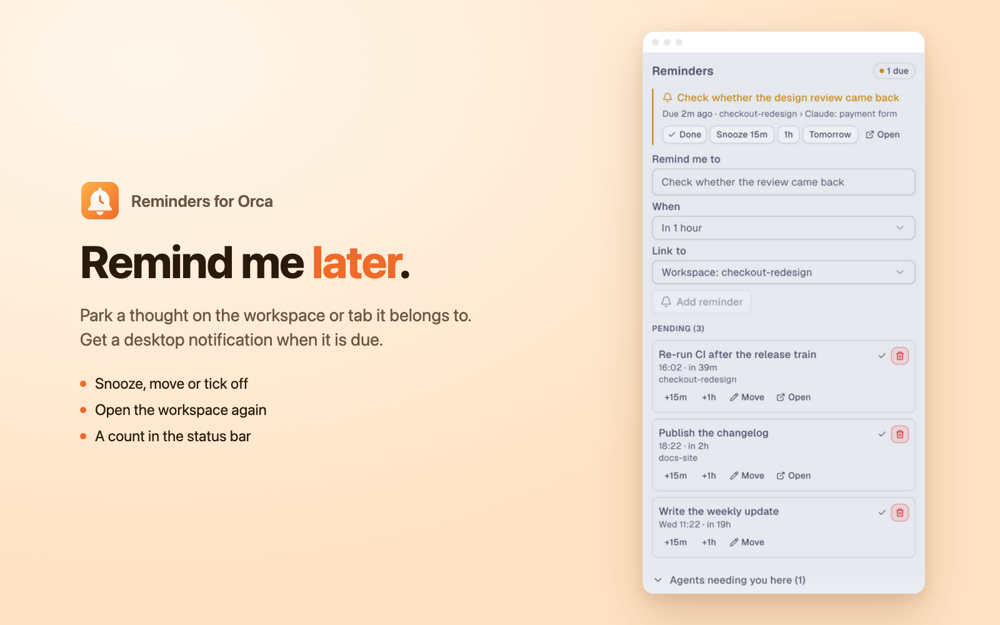
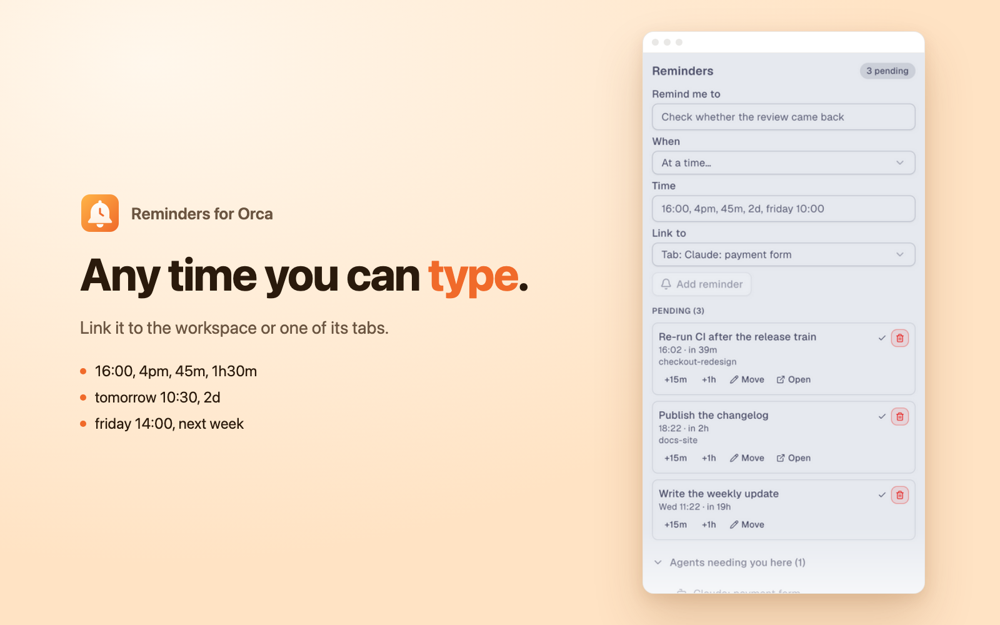

# Reminders for Orca



**Remind me later about this workspace or tab, without leaving Orca.**

Running several agents at once means a lot of work waits on someone else: a review, a CI run, a
colleague's reply, an agent that will be done in an hour. Reminders lets you park that thought on
the workspace or tab it belongs to, get a desktop notification when it is due, and then snooze it,
move it, jump back to the workspace, or tick it off.

[Open in Orca](https://onorca.dev/plugins/ronancodes.reminders?catalog=community) ·
[Changelog](CHANGELOG.md) · [Report a problem](https://github.com/RonanCodes/orca-reminders/issues)

## Contents

- [Install](#install)
- [Quick start](#quick-start)
- [Setting a reminder](#setting-a-reminder)
- [Times you can type](#times-you-can-type)
- [When a reminder is due](#when-a-reminder-is-due)
- [Snooze, move, open, done](#snooze-move-open-done)
- [Command palette](#command-palette)
- [Status bar](#status-bar)
- [Settings](#settings)
- [Agents needing you](#agents-needing-you)
- [Privacy and the access it asks for](#privacy-and-the-access-it-asks-for)
- [FAQ](#faq)
- [Known limits](#known-limits)
- [Develop](#develop)

## Install

From Orca: **Settings → Plugins**, open the community catalog and search for **Reminders**, or
use the [install link](https://onorca.dev/plugins/ronancodes.reminders?catalog=community). Orca
shows what the plugin asks for before anything runs.

Reminders needs Orca 1.4.248 or newer. Version 0.1.0 still installs on 1.4.246 and 1.4.247.

From a checkout, for development:

```sh
git clone https://github.com/RonanCodes/orca-reminders
orca plugin dev load ./orca-reminders   # prints what it would grant, then re-run with --approve <fingerprint>
```

## Quick start

1. Open the **Reminders** panel (the bell in the right sidebar).
2. Type what to be reminded about, pick **When** and **Link to**, and press **Add reminder**
   (or Enter).
3. Carry on working. When it is due you get a desktop notification, the status bar shows
   `1 due`, and the reminder sits at the top of the panel until you deal with it.

Or skip the panel: open the command palette and run
**Reminders: Remind me in 1 hour about this workspace**.

## Setting a reminder

The panel's form has three fields:

| Field | What it does |
| --- | --- |
| **Remind me to** | What the reminder says, up to 500 characters. |
| **When** | In 15 minutes, in 1 hour, in 3 hours, tomorrow morning, next Monday morning, or **At a time…**, which opens a field for any time you can type. |
| **Link to** | Nothing, the focused workspace, or one of its tabs (terminals and agent chats). The choice is remembered for next time. |

A reminder linked to a workspace remembers which one, so you can open it later even after you
have moved on to other work. A reminder linked to a tab also names the tab, so you know which
agent or terminal to look at.



## Times you can type

The **At a time…** field and **Move** both understand plain text:

| You type | It means |
| --- | --- |
| `15m`, `45 min`, `90` | That many minutes from now. |
| `1h`, `2 hours`, `1h30m`, `in 3h`, `+20m` | That long from now. |
| `16:00`, `4pm`, `9.30`, `at 4:15pm` | That time today, or tomorrow if it has passed. |
| `tomorrow`, `tomorrow 10:30`, `tomorrow at 7pm` | Tomorrow, at the morning time unless you give one. |
| `2d`, `in 3 days` | Same time of day, that many days from now. |
| `friday`, `fri 14:00`, `next monday at 10` | The next such day, at the morning time unless you give one. |
| `next week` | Next Monday at the morning time. |

Times are your computer's local time. Days are counted on the calendar, so `tomorrow 09:00` is
09:00 even across a daylight saving change, while `12h` is exactly twelve hours.

## When a reminder is due

- A **desktop notification** shows the reminder and where it belongs, such as
  `checkout-redesign › Claude: payment form`.
- The **status bar** count turns to `1 due`.
- The **panel** shows it at the top in a warning card with **Done**, **Snooze 15m**, **1h**,
  **Tomorrow** and **Open**.

If Orca was closed when a reminder came due, it fires as soon as Orca starts again, and the
notification says when it was due (`was due 14:00`), so you know it is late rather than new.

## Snooze, move, open, done

Every pending reminder has the same actions:

| Action | What happens |
| --- | --- |
| **+15m**, **+1h** | Moves it that far from now. |
| **Move** | Opens a field for any time you can type (see above). Enter saves. |
| **Open** | Shows the reminder's workspace in Orca, as clicking it in the sidebar does. |
| **✓ Done** | Ticks it off. The last 20 done reminders stay in a collapsed **Done** list. |
| **🗑 Cancel** | Deletes it. |

A due reminder adds **Snooze 15m**, **1h** and **Tomorrow**. **Clear done** empties the done list.

If you delete a workspace, its reminders stay but say `(workspace removed)` and lose the Open
button, so nothing points at a workspace that no longer exists.

## Command palette

| Command | What it does |
| --- | --- |
| Reminders: Remind me in 15 minutes about this workspace | Sets "Check back on <workspace>" for 15 minutes from now. |
| Reminders: Remind me in 1 hour about this workspace | The same, in an hour. |
| Reminders: Remind me tomorrow morning about this workspace | The same, tomorrow at the morning time. |
| Reminders: Show pending reminders | A notification listing what is due and pending. |
| Reminders: Snooze due reminders 15 minutes | Snoozes everything that is due. |
| Reminders: Mark due reminders done | Ticks off everything that is due. |
| Reminders: Open the workspace of the oldest due reminder | Jumps to the workspace that has waited longest. |

The three "remind me" commands appear only while a workspace is open. Each confirms with a short
notification.

## Status bar

A bell in Orca's status bar shows how many reminders are pending (`3`), or how many are due
(`1 due`, in the warning colour). It hides when there is nothing open. Pressing it runs
**Show pending reminders**. You can turn it off in Settings.

## Settings

**Settings → Plugins → Reminders**:

| Setting | Default | What it does |
| --- | --- | --- |
| Morning time | 09:00 | What `tomorrow`, `next week` and a weekday without a time mean. 07:00 to 10:00. |
| Show the count in the status bar | On | Turn off to hide the bell and count. |

## Agents needing you

Below the reminders, the panel lists the agents in the focused workspace that are **blocked**,
**waiting** or **done**, with how long they have been that way. It is a quick way to see what to
set a reminder about, or what to deal with first. Agents that are working are left out.

## Privacy and the access it asks for

Reminders runs a small worker (Orca's `trusted-worker` profile) because something has to keep
time while the panel is closed. It asks for:

| Capability | Why |
| --- | --- |
| `storage:own` | Keep the reminder list in the plugin's own storage. |
| `settings:own` | Read the morning time and status bar settings. |
| `notifications:show` | Tell you when a reminder is due. |
| `workspace:read` | Name the workspace and list its tabs for **Link to**, and notice a removed workspace. |
| `workspace:write` | **Open** a reminder's workspace. It never creates, renames or deletes one. |
| `agent:read` | List the agents that need you, and wake the worker on agent changes. |

No network access, no terminal access, no secrets, no analytics. Your reminders stay on your
machine, in Orca's data folder for this plugin. The code is short and readable: start at
[`src/worker.ts`](src/worker.ts).

## FAQ

**Can a notification have Snooze and Done buttons?**
Not yet: Orca's plugin notifications are a title and a body. Snooze and Done are in the panel,
the palette and the status bar.

**Can Open jump to the exact tab?**
Not yet. Orca lets a plugin show a workspace but not focus a tab inside it, so Open shows the
workspace and the reminder names the tab.

**Can an agent set a reminder for me?**
Not from the CLI yet. That needs an Orca command such as the `orca reminder add` proposed in
[stablyai/orca#39059](https://github.com/stablyai/orca/issues/39059).

**I updated from 0.1.0. Do my reminders carry over?**
Yes. They keep their text, time and link. Open finds their workspace by name and branch.

**Why did Orca ask me to approve the update?**
0.2.0 asks for two new capabilities (`workspace:write` for Open, `settings:own` for settings) and
adds commands and a status bar item. Orca reviews any update that asks for more.

**Will it fire if my computer was asleep?**
Yes, as soon as Orca's worker runs again after wake, with "was due" in the notification.

## Known limits

- Notifications have no buttons, and Open cannot focus a tab (see the FAQ).
- Times are local time only; there is no time zone picker.
- No repeating reminders yet.

## Develop

```sh
orca plugin types .      # writes .orca/types for tsc
npx tsc -p .             # type-check
orca plugin test .       # unit tests (src/*.test.ts) with orca/testing
orca plugin check .      # renders the panel with the worker in each src/panel.check.ts scenario
orca plugin dev watch .  # load into Orca, reload on save, stream logs
```

`src/schedule.ts` holds the pure logic (parsing times, firing, snoozing, notification text),
`src/worker.ts` owns storage, the timer, the status bar and the commands, `src/panel.tsx` is the
panel, and `src/protocol.ts` types the requests between them. The README and catalog images come
from the scenarios in `src/panel.check.ts` (`orca plugin shot . --scenario "busy light"`).

Issues and pull requests are welcome.

If Reminders saves you a context switch, a star on GitHub helps other Orca users find it.

## License

MIT
