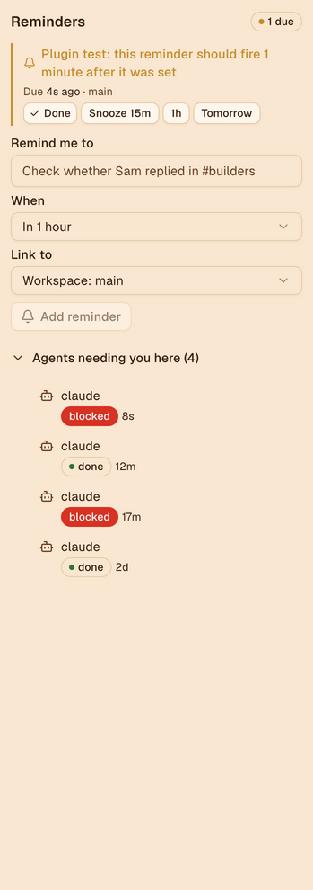

# Reminders for Orca

"Remind me later" for [Orca](https://github.com/stablyai/orca). Set a reminder from a sidebar
panel or the command palette, tie it to the workspace or tab you are in, and get a desktop
notification when it is due. Snooze it, move it, cancel it or tick it off.

Built for running many agents at once, where a lot of work waits on someone else ("give Sam an
hour to reply", "check CI after the release train"). It covers the **remind me** half of
[stablyai/orca#39059](https://github.com/stablyai/orca/issues/39059); waking the tab's agent
with a prompt still needs support in Orca itself (a plugin cannot type into a chat tab).



## What it does

- **Add** a reminder: what, when (in 15 minutes, 1 hour, 3 hours, tomorrow 09:00, or a time you
  type such as `16:00`, `4pm`, `45m`, `1h30m`, `tomorrow 10:30`), and optionally which workspace
  or tab it is about.
- **Notify** when it is due, with a desktop notification naming the workspace or tab, and a due
  card at the top of the panel.
- **Snooze** (15m, 1h, tomorrow), **move** to any time, **cancel**, or mark **done**. The last 20
  done reminders stay in a collapsible list.
- **Palette commands**: `Reminders: Remind me in 15 minutes / 1 hour / tomorrow at 09:00 about
  this workspace`, and `Reminders: Show pending reminders`.
- **Agents needing you here**: the agents in the focused workspace that are blocked, waiting or
  done, with how long they have been that way.
- Reminders live in the plugin's own storage, so they survive an Orca restart. One that came due
  while Orca was closed fires as soon as Orca starts the worker again (any agent or workspace
  change, or opening the panel).

## Access it asks for

It runs a small worker (the `trusted-worker` profile), because something has to keep time while
the panel is closed. It asks for:

| Capability | Why |
| --- | --- |
| `storage:own` | Keep the reminder list. |
| `notifications:show` | Tell you when one is due. |
| `workspace:read` | Name the workspace and list its tabs for "Link to". |
| `agent:read` | Wake the worker on agent changes, and list agents that need you. |

No network access, no terminal access, no secrets.

## Install

From Orca: **Settings → Plugins**, search for Reminders in the community catalog. Or from a
checkout:

```sh
git clone https://github.com/RonanCodes/orca-reminders
orca plugin dev load ./orca-reminders   # prints what it would grant, then re-run with --approve <fingerprint>
```

## Develop

```sh
orca plugin types .      # writes .orca/types for tsc
npx tsc -p .             # type-check
orca plugin test .       # unit tests (src/*.test.ts) with orca/testing
orca plugin check .      # renders the panel with the worker in each src/panel.check.ts scenario
orca plugin dev watch .  # load into Orca, reload on save, stream logs
```

`src/schedule.ts` holds the pure logic (parsing times, firing, snoozing), `src/worker.ts` owns
storage and the timer, `src/panel.tsx` is the panel, and `src/protocol.ts` types the requests
between them.

## Known limits

- A plugin cannot open a workspace or focus a tab, so a reminder names its workspace and tab
  rather than linking to it.
- Orca stops idle plugin workers after 5 minutes. While a reminder is pending the worker checks
  storage once a minute, which keeps it running, so reminders fire within seconds of their time.
- Agents cannot create reminders from the CLI yet; that would need an Orca command such as the
  `orca reminder add` proposed in the issue.

## License

MIT
